# BLW York Hub

[](https://github.com/Amber-E-Moseri/club_management/actions/workflows/ci.yml)

**BLW York Hub is a full-stack community operations platform that brings membership, outreach, meetings, communications and growth workflows into one connected system.**

It is built with React, TypeScript and Supabase. Row-level security (RLS) is the authorization layer, and a release certification job replays every migration from an empty database and checks the result against a reviewed schema contract.

> **Status note:** on the latest CI run on `main`, the `build-test` job passed and the `certification` job failed because of the Bible study class migrations (040–042). See [Testing and verification](#10-testing-and-verification) and [Roadmap](#12-roadmap-and-status).

---

## 1. BLW York Hub

| | |
|---|---|
| **Purpose** | Run a church community's membership, cells, outreach, meetings and communications from one app |
| **Users** | Members, cell leaders, admins and coordinators at BLW York |
| **Stack** | React 18, TypeScript (strict), Tailwind CSS, Supabase (Postgres, Auth, Edge Functions), Vercel |
| **Applications** | Two: the private BLW York Hub (`src/`) and the public website (`site/`, a separate Vite app). See [The two applications](#the-two-applications-and-how-they-relate) |
| **Repository** | This repository. Start with [Getting started](#9-getting-started) |

---

## 2. Why I Built It

While serving at BLW York, I saw how much administrative information was spread across forms, spreadsheets and separate platforms. Member details, cell assignments, follow-ups and meeting records each lived somewhere different, so keeping track of people took effort that should have gone into ministry.

I built the Hub to meet that need with the skills I have. The goal is a single place where each person's information is accurate, access is limited to the people who need it, and leaders can see what needs attention without digging through several tools.

---

## 3. Product Overview

**Who uses it**

- **Members** sign up, wait for approval, keep their profile up to date, and use growth tools such as the daily devotional and confessions.
- **Cell leaders** see their cell, its Bible study classes (BSCs), and their members' reading progress, and they manage outreach follow-ups.
- **Admins and coordinators** approve new accounts, manage people, cells and roles, send announcements and email, and run reports and exports.

**Needs it addresses**

- One source of truth for people, cells and assignments.
- Outreach follow-up that does not depend on personal notebooks.
- Meeting records and attendance in one place.
- Email and push notifications that go out through a controlled path.
- Access that matches a person's role, with private information limited to the people who need it.

---

## 4. Features

**Status key**

- **Merged** means the change is on `main`, either through a merged pull request (PR number given) or a direct commit.
- **Branch only** means the change is pushed to a branch with no pull request yet.
- **Needs migration NNN** means the feature needs that numbered migration applied to the target database.

Whether a merged change is live depends on the production release. This README does not verify that.

### The two applications and how they relate

| | BLW York Hub | Public website |
|---|---|---|
| **Location** | `src/` | `site/`: a separate Vite 6 app with React 18, its own `package.json`, tests and build |
| **Audience** | Members, cell leaders, admins and coordinators | Visitors, and editors who use the CMS at `/admin` |
| **Data access** | Private operational tables, read with the signed-in user's JWT under RLS | Published content only, read with the anon key. Writes go through narrow functions |
| **Website Management** | Mounted at `/admin/website` from `src/website/` | The `/admin` area of the public site, loaded only on that path (`site/src/admin/`) |

**Shared and copied code on `main`.** There is no shared package. `websiteApi.ts` is byte-identical in `src/website/api/` and `site/src/api/`. Four admin files are also identical. `ContentScreens.tsx` is the one that differs. Two copies of the same client can drift apart, and this is on the [roadmap](#12-roadmap-and-status).

**Integration status on `main`.**

- **Merged:** the public website (PR [#72](https://github.com/Amber-E-Moseri/club_management/pull/72)) and Hub Website Management (PR [#74](https://github.com/Amber-E-Moseri/club_management/pull/74)).
- **Not on `main`:** the database objects and functions that both apps call. The migrations do not create the `web_*` tables, the `web_*` functions or the `v_public_*` views. `supabase/functions` has no `website-inquiry`, `website-media-upload` or `website-rhapsody-pdf` function. The storage buckets `site-media` and `rhapsody-pdfs` are not created by any migration on `main` either. So neither app's website calls have a backend in this repository's current migrations.
- **Not verified here:** whether either app is deployed and live.

### Public website: what the code does

The public site is in `site/`. It has pages for the home page, about, events (with detail pages), Rhapsody editions with PDF downloads, blog posts (with detail pages), "New here", contact, Foundation School, and a not-found page.

- **Reads published content only.** It reads pages, settings and navigation, blog posts, public events and editions through `v_public_*` views. Those views are not on `main` (see above).
- **Forms.** Contact, "New here" and prayer requests go through a protected inquiry path. That path is designed to check Turnstile and a per-client limit before the database accepts a message. The Edge Function that does those checks is not on `main`.
- **Configuration safety.** The client refuses an anon key that carries the service-role claim, and `site/src/__tests__/config.test.ts` covers that case.

### Website CMS: drafting, publishing and version conflicts

The client code in `websiteApi.ts` and the admin screens in `site/src/admin/` show these behaviours. The database functions they call are not on `main`.

- **Content** (page, settings, navigation): edits save as a draft with a draft version. Publishing sends the draft version the editor loaded, and creates a new published version with a note. Earlier versions can be listed and rolled back.
- **Blog posts:** draft, published or archived, with an optional publish time and a version number.
- **Events:** each event has a public title, summary, registration link, a featured flag and a version number.
- **Editions (Rhapsody):** kind, period, title, linked PDF and a version number.
- **Conflicts:** every save sends the version the editor loaded. A stale save is rejected by the database with error `40001`, and the client maps that to a conflict error. The admin screens show the error message. They do not offer a reload or a merge.
- **Rate limits:** the client maps error `P0429` to a rate-limited error. The limiter itself is not on `main`. The shared guard module only extracts the caller's address.
- **Roles:** the CMS has its own roles, assignments and permission checks (`web_roles`, `web_role_assignments`, `web_my_permissions`). Their database objects are not on `main`.

### Audience targeting for events and messages

Audience targeting is merged, and its database dependencies are on `main`. Deployment is not verified.

- **Weekly messages** (migration [041](supabase/migrations/041_message_audience_targeting.sql)): adds `audience_type` (`org`, `cell`, `bsc` or `member`) and `audience_id`. Cards show the audience label. **Not enforced:** the read policy from migration 017 allows only `scope = 'org'` or the creator, and no list query filters on the audience. A targeted message can therefore be read by anyone who can read org-scope messages.
- **Events** (migration [038](supabase/migrations/038_event_audience_and_notifications.sql)): `audience` is `all` or `meeting`. `all` sends push notifications to every active member with push enabled. `meeting` sends them to the people assigned to the event's meeting. Events do not use the cell, BSC or member scopes that weekly messages use.

### Identity and access

| Feature | Status |
|---|---|
| Google sign-in (Supabase Auth) | Merged |
| Pending approval gate for new accounts | Merged |
| Built-in roles: member, cell leader, admin, coordinator | Merged |
| Custom admin roles and permission assignment (Roles & access) | Merged; a redesigned layout is **branch only** (`admin/roles-access-layout`) |

### People and outreach

| Feature | Status |
|---|---|
| People directory with search and role/cell filters | Merged; BSC fields need migrations 040 and 042 |
| Member detail panel and profile editing | Merged |
| Outreach contacts, tags, follow-ups and audit trail | Merged |

### Community coordination

| Feature | Status |
|---|---|
| Cells, with a coordinator form to create one | Merged (PR #68) |
| Bible study classes (BSCs) inside cells | Merged; needs migrations 040–042 |
| Reading progress (ROR) and streaks | Merged (PR #70); needs migration 039 |
| BSC contact visibility with sensitive-field masking | Merged; needs migration 042 |

### Meetings and events

| Feature | Status |
|---|---|
| Meetings with agenda, minutes and attendance | Merged |
| Zoom integration | Merged; needs Zoom credentials in Supabase secrets |
| Events, RSVPs and reminders | Merged |
| Event audience: everyone with push enabled, or the people assigned to a meeting | Merged; needs migration 038. Events do not use the cell, BSC or member scopes that weekly messages use |

### Communications

| Feature | Status |
|---|---|
| Announcements | Merged |
| Announcement push notifications (`notify-announcement`) | Merged |
| Email: templates, composer, scheduling and unsubscribe | Merged; resend safety in PR #71 |
| Weekly messages with audience targeting (org, cell, BSC or member) | Merged; migration 041 adds the columns. The audience is shown on the card, but **the database and the list queries do not yet enforce it** (see [Engineering challenges](#8-engineering-challenges)) |
| Mobile navigation drawer (More tab) | Merged (PR #69) |

### Spiritual growth

| Feature | Status |
|---|---|
| Monthly devotional (Daily Bread) with read tracking | Merged |
| Habits, testimonies, book of the month | Merged |
| Daily confessions | Merged; the fix for a production error is **branch only** (`fix/confession-declarations-embed`) |

### Public website and website management

| Feature | Status |
|---|---|
| Public website served at `/site` on the Hub domain | Merged (PR [#72](https://github.com/Amber-E-Moseri/club_management/pull/72)) |
| Website management inside the Hub (frontend port, no migrations) | Merged (PR [#74](https://github.com/Amber-E-Moseri/club_management/pull/74)) |
| Public website app (`site/`): a separate Vite app with its own build and tests | Merged in the repository; deployment is configured by `site/vercel.json` |
| Website CMS: draft and published versions, conflict detection (409 / Postgres `40001`), media upload checks | Front end merged. **The backend is not in `main`'s migrations or Edge Functions**, so the CMS endpoints it calls are not defined by this repository. See [Roadmap](#12-roadmap-and-status) |
| Rate limiting for website endpoints | **Not implemented on `main`.** The shared guard module only extracts the caller's address for a rate-limit key |

---

## 5. Product Gallery

Screenshots of the app running with demo data (fictional names, `example.test` emails and `555` phone numbers). They are stored in [docs/screenshots/](docs/screenshots/).

**Dashboard and approvals**

| Dashboard | Pending approval (new account) |
|---|---|
| 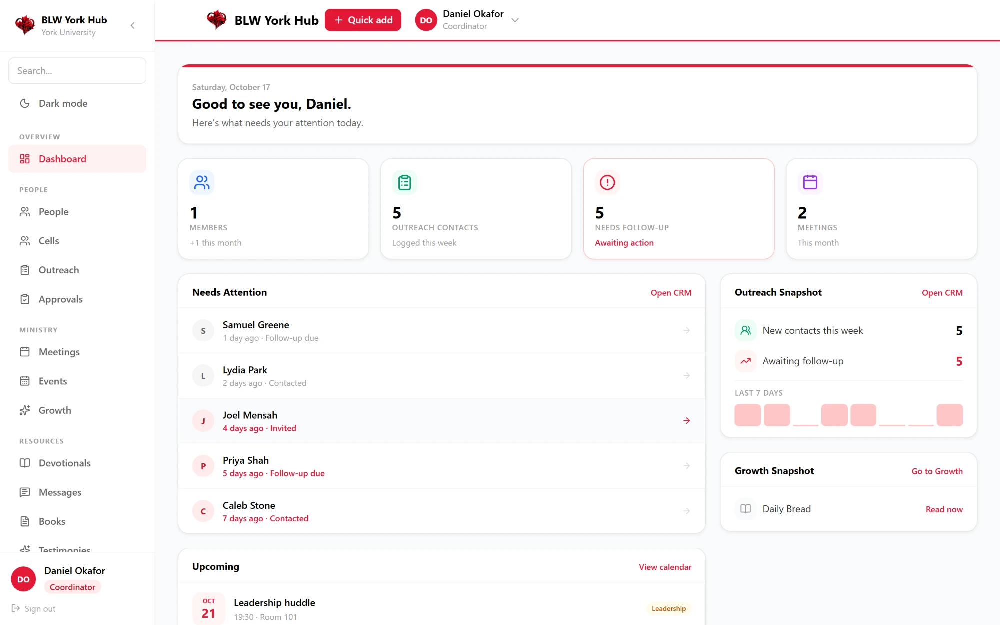 | 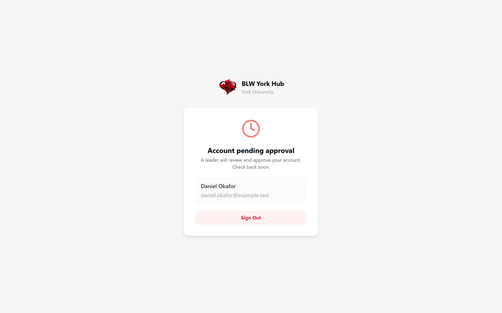 |

| Approvals queue | Approval confirmed |
|---|---|
| 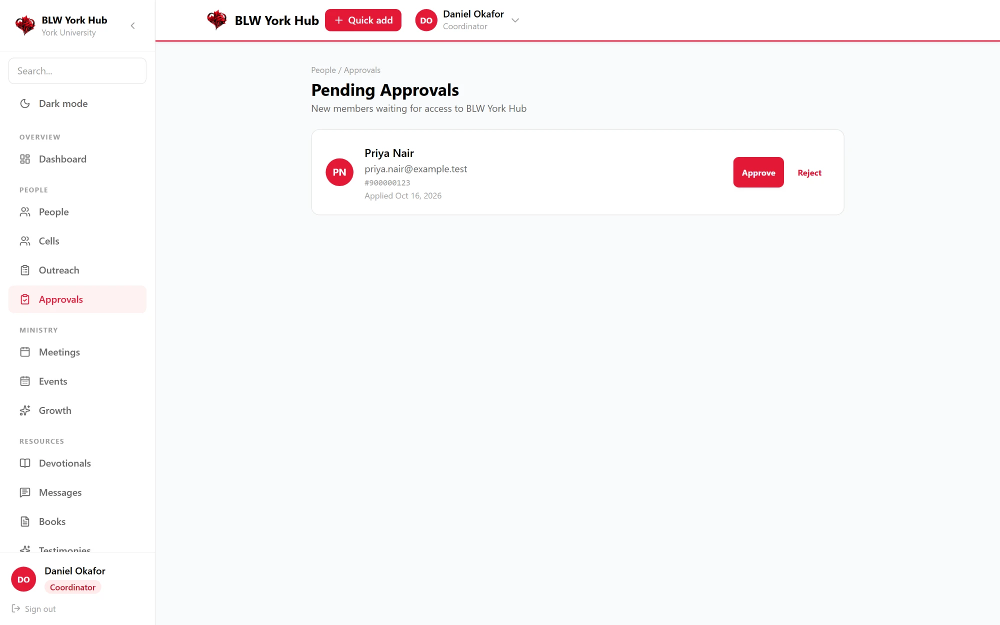 | 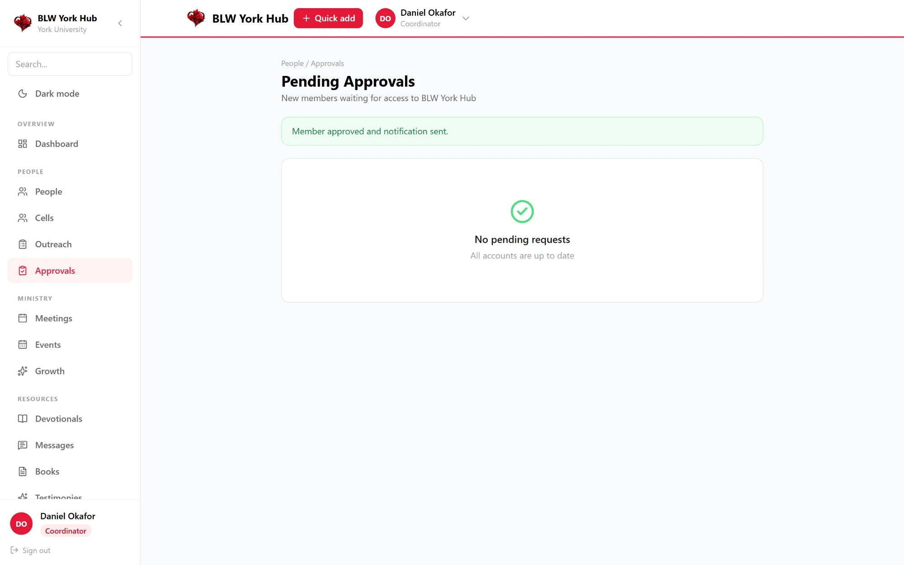 |

**Outreach**

| Outreach CRM | Log a contact |
|---|---|
| 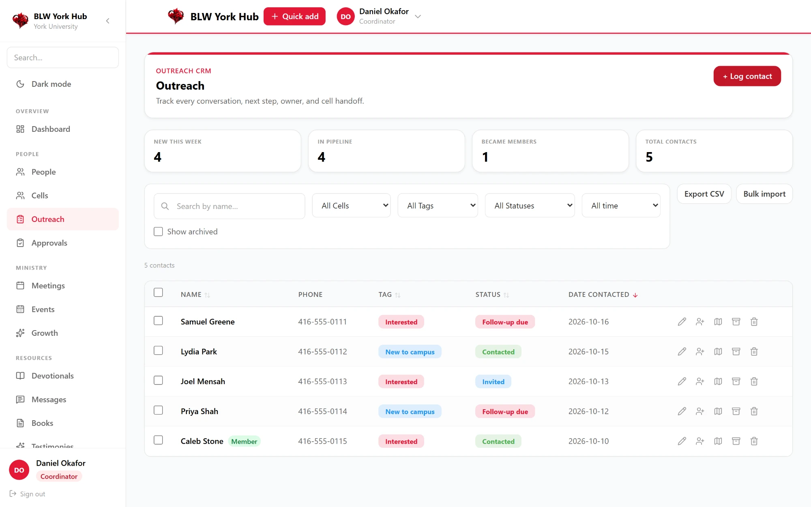 | 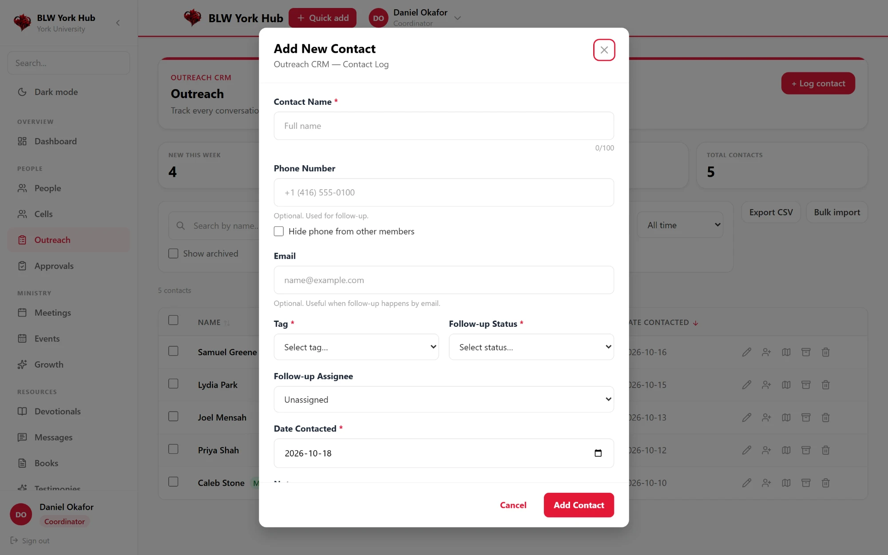 |

| Contact details, follow-up and audit log |
|---|
| 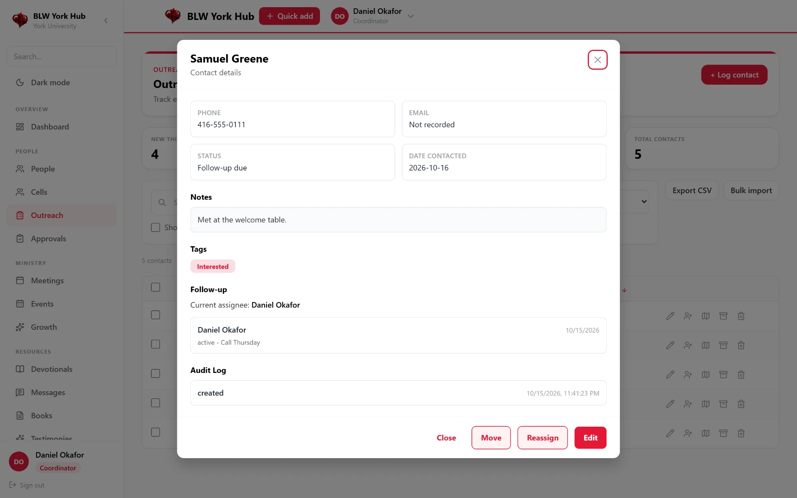 |

**Meetings, events and cells**

| Meetings | Events |
|---|---|
| 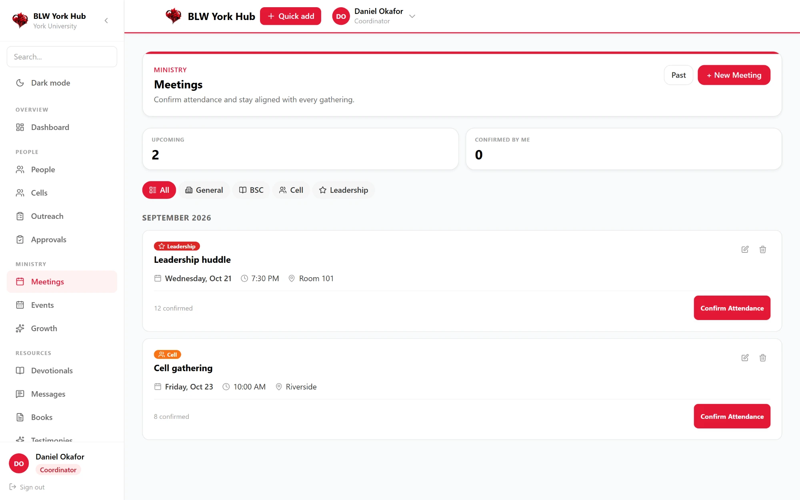 | 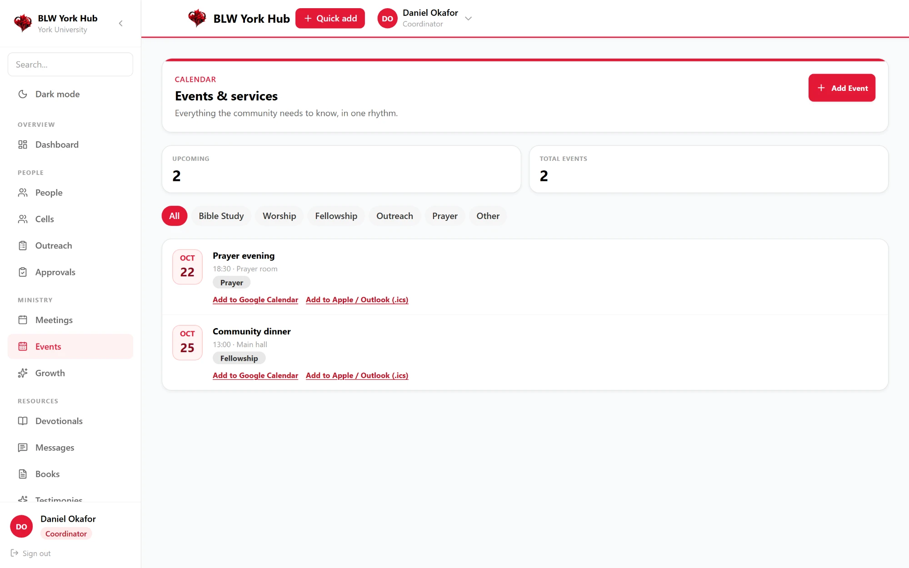 |

| Add event | Cells and reading progress |
|---|---|
| 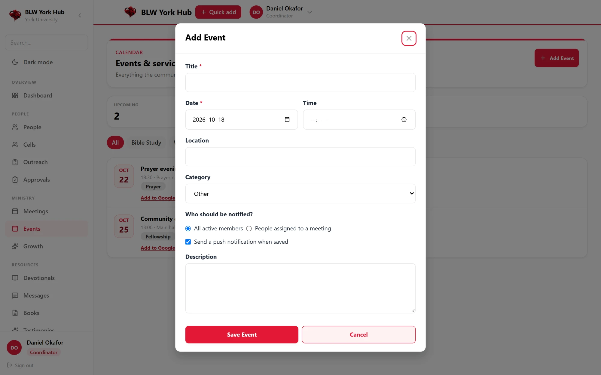 | 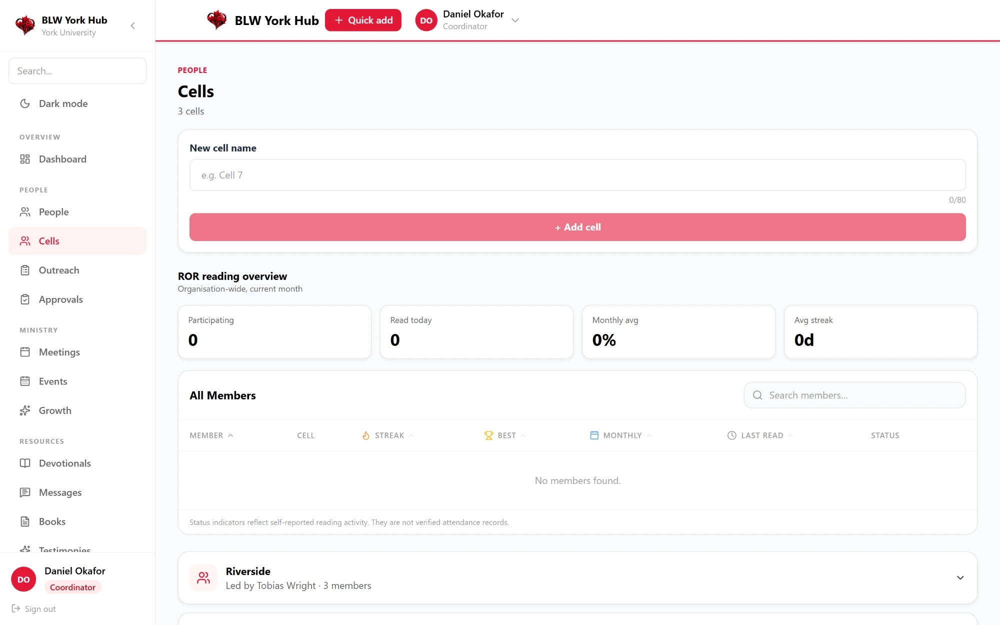 |

**Communications, growth and access**

| Communications and email composer | Growth |
|---|---|
| 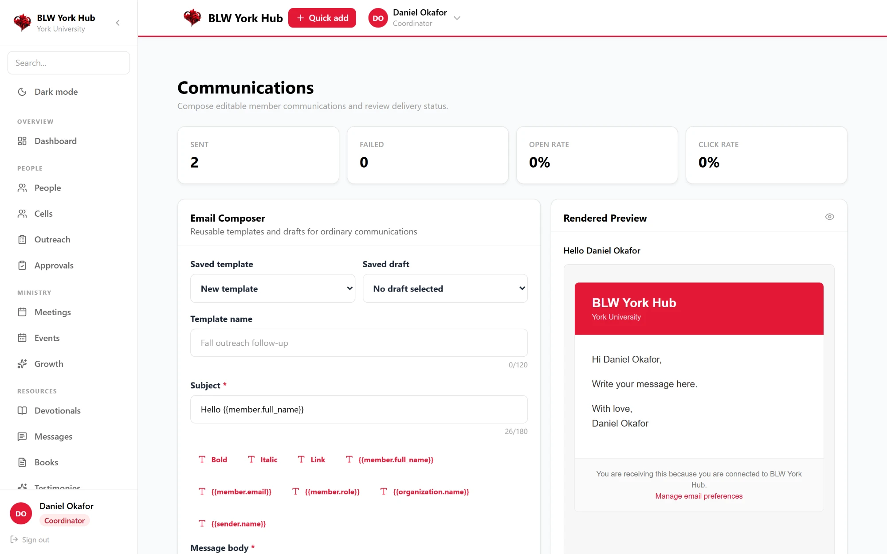 | 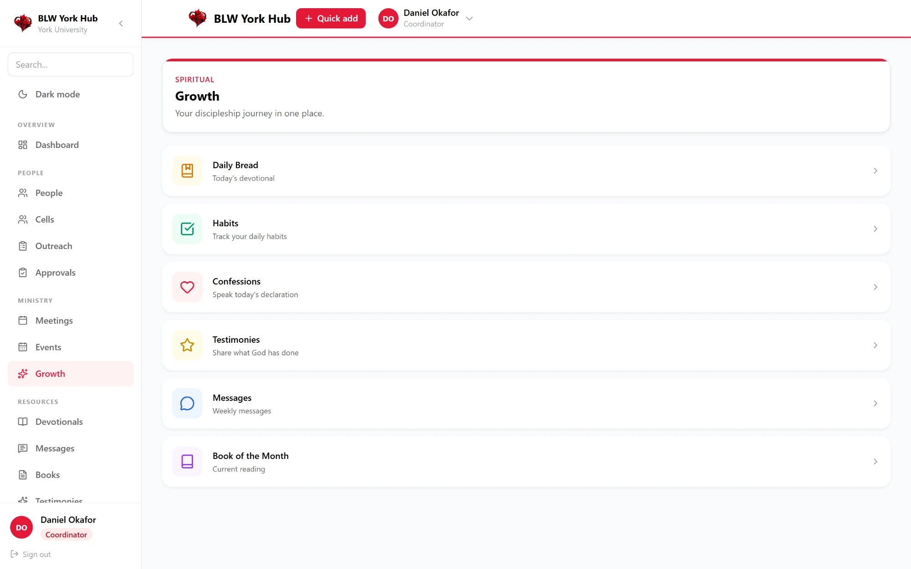 |

| Roles & access |
|---|
| 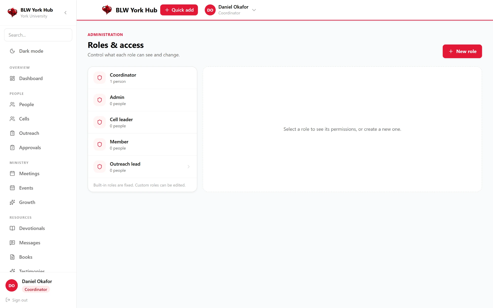 |

A mobile navigation screenshot is still to be added.

---

## 6. Architecture

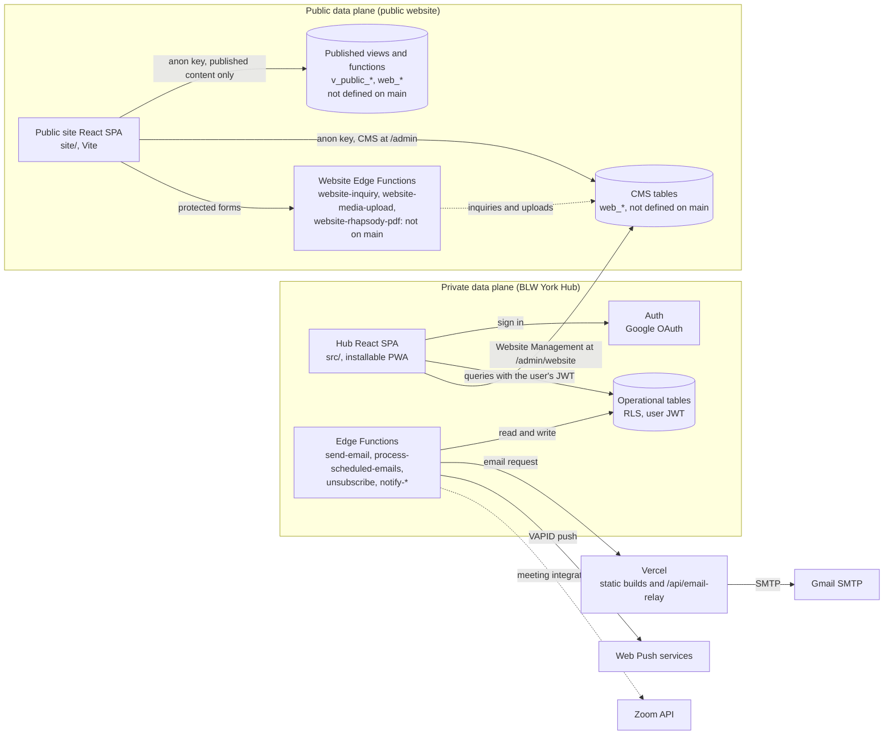

**Technology choices**

- **React and TypeScript** keep the UI typed end to end, and the app ships as a static build.
- **Supabase** provides Postgres, Auth and Edge Functions. Authorization lives in the database through RLS, not in the browser.
- **Vercel** hosts the static build and the one serverless function that holds the Gmail credentials.
- **Web Push (VAPID)** and a service worker make the app installable and able to send notifications.
- **Vite 6 and React 18 (public site):** the public website is a separate app in `site/`, built with `vite build` into `dist/`. It shares no package with the Hub.

---

## 7. Security and Authorization

Access is enforced in layers. Each layer assumes the one above it can fail.

**1. Authentication.** Members sign in with Google through Supabase Auth.

**2. Approval gate.** A new account starts as `member` with a `pending` status. Pending accounts can read only their own profile, and the database refuses them the data that active members see. Admins approve accounts through a database function, not from the browser. The design is in [docs/database-and-identity.md](docs/database-and-identity.md).

**3. Roles and permissions.** The app has four built-in roles (`member`, `cell_leader`, `admin`, `coordinator`). Coordinators can also create custom admin roles, each a set of permission keys. The UI uses these roles to decide what to show, but the database policies decide what is allowed. Capability definitions are in [docs/blw-authorization-matrix.md](docs/blw-authorization-matrix.md). That document is the design target. Parts of it, such as contact reps and check-in, are not in the code yet.

**4. Database access.** Tables are created with RLS enabled, and privileges are granted explicitly rather than by default. The `anon` role has no table access. Migration rules require every new table to ship with its policies and grants in the same migration, and every function to pin its `search_path`. About a dozen of the 43 migrations are hardening, guard or grant fixes, so much of the authorization work was corrected after the first schema was in place.

**5. Private data.** Contact details are masked for peers who should see a person's presence but not their private fields. Authorization reads the `profiles` table, never `user_metadata`, because signed-in users can change their own metadata.

**6. Public boundary.** The public website uses only the anon key and refuses a service-role key. It reads published content through views and writes through narrow functions. Those database objects are not on `main` yet, so this boundary cannot be checked against this repository's schema (see [Roadmap](#12-roadmap-and-status)).

**7. Secrets.** The Gmail credentials exist only in Vercel. The email relay rejects any request without the shared secret. Unsubscribe links are signed inside an Edge Function, so no signing key reaches the browser. Browser variables (`REACT_APP_*`) are public by design and never hold a secret.

**What is not in this README:** endpoint URLs, project identifiers, keys, secrets and member data. Those stay in the environment and the Supabase and Vercel dashboards.

---

## 8. Engineering Challenges

### Role-based authorization across two kinds of roles

- **Problem.** The app has built-in roles stored on each profile and custom admin roles that carry permission keys. The UI and the database both need to agree on who can do what.
- **Decision.** Authorization reads from the database. The UI hides what a person cannot use, but RLS and database functions are the real gate. The Roles & access page reads from the same tables the policies use.
- **Result.** The permission model is consistent in the schema. Built-in roles are read-only in the UI, and custom roles are editable. Whether the permission names in the admin screen should match the database keys exactly is still open. See the [roadmap](#12-roadmap-and-status).

### Protecting member records

- **Problem.** Bible study class leaders need to see who is in their class, but not every private field of every person.
- **Decision.** Contact visibility is handled in the database, in migration 042, with sensitive fields masked for peers. The UI does not decide what to reveal.
- **Result.** The masking rule lives with the data. The certification job flagged that the new BSC objects are not yet in the reviewed schema contract, so this work is not certified yet (see the next section).

### Keeping migration history, the live database and the certified schema in step

- **Problem.** Migrations 040–042 added Bible study class objects. Two things went wrong. The development project was missing them, which caused errors on the People and Daily Confessions pages. And the release certification job, which replays every migration and compares the result to a reviewed schema contract, started failing on `main`.
- **Decision.** No blind `db push` to a database with live data. Production was checked with read-only queries first. The Daily Confessions error was a code bug, so it was fixed in code on its own branch. The certification failure is being handled by updating the reviewed schema contract, not by weakening the check.
- **Result.** The read-only production check confirmed the BSC columns and the declarations table shape. The certification job caught the drift, which is what it is for. The certification job failed on the last completed run on `main`. It stays failing until the contract is updated and the BSC read policy is changed. The details are in [docs/certification-status-040-042.md](docs/certification-status-040-042.md). The development database still needs migrations 040–042 applied.

### Separating private operational data from public content

- **Problem.** The same organisation runs member records and a public website. Visitors must never reach a private row, and two editors must not overwrite each other's published content.
- **Decision.** The public site uses only the anon key and reads published content through views. Its writes go through narrow functions: forms through a protected inquiry path, and CMS saves with the version the editor loaded. The client refuses a service-role key. Hub Website Management and the public site's `/admin` area are two entry points to the same CMS client.
- **Result.** The client, the configuration check and the save-with-version logic are implemented and unit-tested in `site/`. The database side is not verified here: the views, functions and Edge Functions that enforce the boundary are not on `main`. The duplicated client is also a maintenance risk (see the [roadmap](#12-roadmap-and-status)).

### Safe email delivery

- **Problem.** The app needs to send email from a serverless environment without exposing Gmail credentials or letting anyone use the relay.
- **Decision.** Edge Functions call a single Vercel relay. The relay holds the Gmail credentials and checks a shared secret. Every send is logged, and unsubscribe links are signed server-side.
- **Result.** Credentials never reach the browser. Email requests are recorded in `email_log`, and scheduled sends are tracked in `scheduled_emails`. Resends require a per-email confirmation (PR #71).

### Responsive mobile navigation

- **Problem.** The app has more pages than fit in a phone's bottom tab bar, and it also has a desktop sidebar.
- **Decision.** The phone uses four tabs plus a More tab. More opens a drawer that lists every page the person's role can see, so no page is hidden on small screens (PR #69).
- **Result.** I checked the bottom navigation and the People, Profile and Daily Confessions pages at 375 px width in a local browser. The layouts render. Lists that depend on data show errors until the target database has the matching migrations.

---

## 9. Getting Started

**Prerequisites:** Node 20 or later, and a Supabase project. Vercel is needed only for email.

```bash
npm install
cp .env.example .env     # then fill in the values below
npm start                # the dev server starts on http://localhost:3000 by default
```

### Environment variables

Browser variables go in `.env`. Every `REACT_APP_*` value is public in the built bundle, so never put a secret in one. The full list is in [.env.example](.env.example).

| Variable | Purpose |
|---|---|
| `REACT_APP_SUPABASE_URL` | Supabase project URL |
| `REACT_APP_SUPABASE_ANON_KEY` | Supabase anon key. Safe to expose because RLS protects the data |
| `REACT_APP_PUBLIC_APP_URL` | Public site URL, used when building links |
| `REACT_APP_VAPID_PUBLIC_KEY` | Web Push public key. Generate with `node scripts/generate-vapid-keys.js` |
| `REACT_APP_GOOGLE_DRIVE_API_KEY`, `REACT_APP_GOOGLE_DRIVE_UPLOAD_ENDPOINT` | Optional: Drive previews and uploads |
| `REACT_APP_SENTRY_DSN` | Optional: error reporting |

Server secrets are set outside `.env`: the Vercel dashboard holds `GMAIL_USER`, `GMAIL_APP_PASSWORD` and `EMAIL_RELAY_SECRET`. Supabase Edge Function secrets hold the relay URL and secret, the signing secrets, and the Zoom credentials. Setup details are in [docs/email-setup.md](docs/email-setup.md).

### Local database

The schema is defined only by the numbered migrations in `supabase/migrations/`, from `000_profiles.sql` through `042_bsc_contact_visibility.sql`. Do not edit the schema in the dashboard.

For a fresh local database, replay everything from empty:

```bash
npx supabase db reset --local
```

Read [docs/database-and-identity.md](docs/database-and-identity.md) before you write a migration.

---

## 10. Testing and Verification

### Continuous integration

The workflow in [.github/workflows/ci.yml](.github/workflows/ci.yml) has two jobs:

| Job | Steps | Latest run on `main` ([run 39095096132](https://github.com/Amber-E-Moseri/club_management/actions/runs/39095096132), commit `8fb1697`) |
|---|---|---|
| `build-test` | `npm ci`, `npm run typecheck`, `npm test`, `npm run build` | **Passed** |
| `certification` | `npm ci`, then `./scripts/certify-local.sh`: replays all migrations on a local Supabase stack and compares the schema with the reviewed contract | **Failed** |

The same pattern appears in the two runs before it: [39095081560](https://github.com/Amber-E-Moseri/club_management/actions/runs/39095081560) (commit `70d8341`) and [39092723147](https://github.com/Amber-E-Moseri/club_management/actions/runs/39092723147) (commit `fb1ed2c`). In each of these, `build-test` passed and `certification` failed. The ten most recent runs on `main` all concluded with a failure.

The CI badge at the top shows the most recent run of the workflow on `main`. A red badge means at least one job failed. A green badge means both jobs passed.

The certification job's failures, from the log of run 39092723147:

- The `bscs` table, the `contacts_bsc_view` view and two BSC helper functions are not in the reviewed schema contract.
- Grants on `bscs` do not match the reviewed matrix.
- One BSC read policy does not require an active, approved account, which the certification rules require.
- The schema fingerprint does not match the golden fingerprint.

The job breakdown was checked for the three most recent runs listed above. Neither unmerged branch has a CI run recorded.

Playwright end-to-end tests are not part of CI. Run them locally.

### Public website checks

The public site has its own checks in `site/`. Run them from that folder after `npm ci`:

```bash
cd site
npm ci
npm run typecheck     # tsc --noEmit
npm test              # Vitest
npm run build         # tsc, then vite build into dist/
```

These checks are not part of `.github/workflows/ci.yml`, which runs only the root app. Run them locally until they are added to CI.

### Run the checks locally

Run these from the repository root after `npm install`:

```bash
npm run typecheck          # tsc --noEmit
npm test                   # Jest unit and contract tests, with coverage
npm run build              # production build into build/
npx playwright install     # first time only: browsers for the e2e suite
npm run e2e                # Playwright end-to-end tests
```

Notes:

- `npm test` runs Jest in CI mode. Use `CI=true npx react-scripts test --watchAll=false <file>` to run one file.
- `npm run e2e` starts its own dev server on port 3100 (see `playwright.config.ts`). The `set PORT=3100&&` in that config is Windows syntax, so on macOS or Linux, change it to `PORT=3100`.
- The Jest suite includes schema-contract, migration-architecture and security-authorization tests. The migration-architecture test checks that protected migrations are unchanged.

**Local runs on 2026-10-17** (on the author's machine, not a CI run):

- Full Jest suite: 39 suites passed, 1 skipped. This run came before the two most recent branch changes.
- Typecheck: passed after the Roles & access redesign.
- Jest suites for people, cells, migrations and security: passed after the confession fix.

### Manual production verification

These checks are not automated. Run them against the production project after any migration or deploy.

1. Check which Supabase project the CLI is linked to with `npx supabase migration list`, and confirm it is the project you expect.
2. Run read-only checks in the production SQL Editor. For example, confirm that `member_directory` has `bsc_id` and that `confession_declarations` has no `id` column.
3. Sign in as a coordinator, then check the People, Cells, Daily Confessions, Devotional and Profile pages.
4. Check the bottom navigation and the More drawer at phone width.

---

## 11. Deployment and Configuration

The full runbook is [docs/clean-production-deployment.md](docs/clean-production-deployment.md). The steps below summarise it. Do not push migrations to a database until you have confirmed which project you are targeting and have a current backup.

### New Supabase project

1. Create the project and configure Auth (redirect URLs and Google sign-in).
2. Apply the schema to the empty database: `npx supabase link --project-ref <NEW_PROJECT_REF>`, then `npx supabase db push`.
3. Run `supabase/verification/schema_fingerprint.sql` in the SQL Editor and check the saved JSON with `node supabase/verification/check_schema_contract.mjs <saved.json> --golden supabase/verification/schema_fingerprint.golden.json`. Every line must be `PASS`.
4. Configure Storage and Edge Function secrets, then deploy the functions with `npx supabase functions deploy`.
5. Create the first administrator once.
6. Deploy to a Vercel preview with the new project's variables, smoke-test it, then set the Production variables and deploy.

### Existing production project

Do not run `db push` against it without reviewing the output. Use the read-only checks above, and apply any change only after review. Keep the previous project's variable values so a rollback is a variable change and a redeploy. Vercel's `REACT_APP_SUPABASE_URL` and `REACT_APP_SUPABASE_ANON_KEY` are the two values to restore.

### Public website build

`site/vercel.json` sets the framework to Vite, the build command to `npm run build` and the output directory to `dist/`. It rewrites every path to `index.html` and sets security headers. The Content-Security-Policy limits scripts to the site and Cloudflare Turnstile, limits connections to Supabase, and allows Google Fonts for styles and fonts. This README does not verify whether a Vercel project for the public site is live.

### Vercel build

`vercel.json` sets the build command to `npm run build` and the output directory to `build`. It rewrites `/api/*` to the serverless functions and sends every other path to `index.html`.

---

## 12. Roadmap and Status

**Merged to `main`:** the features marked "Merged" in [Features](#4-features).

**Branch only, no pull request:**

- `fix/confession-declarations-embed`: stops Daily Confessions from selecting a column that does not exist.
- `admin/roles-access-layout`: redesigns Roles & access into a role list and permission panel.

**Other open pull requests:** draft and review-only certification work ([#15](https://github.com/Amber-E-Moseri/club_management/pull/15), [#16](https://github.com/Amber-E-Moseri/club_management/pull/16), [#17](https://github.com/Amber-E-Moseri/club_management/pull/17), [#18](https://github.com/Amber-E-Moseri/club_management/pull/18), [#19](https://github.com/Amber-E-Moseri/club_management/pull/19), [#54](https://github.com/Amber-E-Moseri/club_management/pull/54)). These are not features of the application.

**Open work:**

- Make the certification job pass on `main`: update the reviewed schema contract and golden fingerprint for migrations 040–042, and tighten the BSC read policy so it requires an active, approved account.
- Apply migrations 040–042 to the development database, then recheck the People and Cells pages.
- Decide whether the permission names in the admin screen should match the database keys, or the keys should change. Either option touches security rules and needs review.
- Decide whether built-in roles should become editable. The database refuses edits to them today.
- Add a mobile navigation screenshot to the product gallery.
- Provide the website backend in this repository: the `web_*` tables and functions, the `v_public_*` views, the `site-media` and `rhapsody-pdfs` storage buckets, and the three website Edge Functions. None of them are on `main`.
- Enforce weekly-message audience in the database policy and in the list queries.
- Replace the two copies of the website client and admin files with one source.
- Add the `site/` checks to CI.
- Add a rate limiter for website endpoints. On `main`, the guard module only extracts the caller's address.
- Make the Playwright server command work on macOS and Linux.

---

## 13. About the Developer

Built by **Amber Moseri** while serving at BLW York.

- **Profile:** [add your LinkedIn or portfolio link]

**What building this taught me:** the most important work was in the requirements. Every screen depended on a rule about who should see what, and those rules were easier to get right by talking to the people who run the ministry than by guessing. Operational workflows, such as approvals, cell assignments and follow-up, shaped the data model more than any framework did. Small changes matter with real users: a missing column can break a page that worked the day before. I also learned to own the whole path, from the migration to the screen to the email that goes out. Each release has revealed a gap that the previous one hid, and the certification job now shows those gaps before they reach production.

---

## Documentation

| Doc | Topic |
|---|---|
| [docs/blw-authorization-matrix.md](docs/blw-authorization-matrix.md) | Capability design for each role |
| [docs/database-and-identity.md](docs/database-and-identity.md) | Identity model, approval enforcement and migration rules |
| [docs/blw-data-model.md](docs/blw-data-model.md) | Tables and relationships |
| [docs/blw-state-authority.md](docs/blw-state-authority.md) | Where each piece of state lives |
| [docs/email-setup.md](docs/email-setup.md) | Gmail relay and Edge Function setup |
| [docs/clean-production-deployment.md](docs/clean-production-deployment.md) | Production build, cutover and rollback |
| [docs/blw-v2-product-map.md](docs/blw-v2-product-map.md) | Product scope |
| [supabase/verification/README.md](supabase/verification/README.md) | Release certification runbook |
